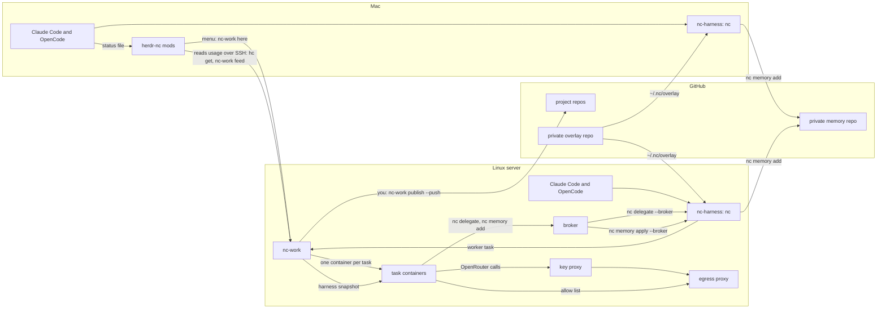

### My AI agent setup

I run Claude Code and OpenCode as a few coding agents on a Mac and a Linux server. These four public repos are the
whole setup; my own rules, model policy and memory live in private repos that plug into them.

| Repo | What it is |
| --- | --- |
| [nc-harness](https://github.com/iAmSerathion/nc-harness) | One CLI (`nc`) for shared rules, roles and skills, a per-folder model policy, shared memory, delegation to OpenCode workers and an orchestrator procedure (crew one, pair or team). |
| [nc-infra](https://github.com/iAmSerathion/nc-infra) | `nc-work`: one rootless Docker container per agent task, behind an egress proxy and a key proxy, plus the broker and a guide for the server underneath. |
| [herdr-nc](https://github.com/iAmSerathion/herdr-nc) | A workspace for the Herdr desktop app: one layout, `nc-*` mods with cards for agents, folders, git, usage and the orchestrator plan, themes, keys and menu entries. |
| [nc-memory-template](https://github.com/iAmSerathion/nc-memory-template) | Template for the shared memory repo the agents read and write. |

On both machines `nc-harness` gives Claude Code and OpenCode the same rules, roles, skills, model policy and memory.
The host is the machine itself, outside any container: the Mac or the server. On the server, agents can also run
isolated: `nc-work` starts one rootless container per task (an nc-work task), with no stored credentials. GitHub pushes
happen on the host, the Claude token is passed per session, and the OpenRouter key stays in a key proxy outside the
agent container that adds it to each OpenRouter call. All other outbound traffic goes through an egress proxy with an
allow list. Each task gets a harness snapshot, a read-only copy of nc-harness with my overlay files. The broker is a
host process that carries out what a task asks for: starting a worker, writing a memory note. The herdr-nc mods on
the Mac show each agent, worker and orchestrator plan, local or on the server; their menu starts isolated sessions
with `nc-work here`.

How the pieces talk:

- **Orchestrator to card.** The orchestrator is the main Claude Code session following the `crew` procedure. It
  records its plan and progress in a status file with `nc orchestrator status`; the herdr-nc mod `nc-orchestrator`
  shows it.
- **`nc delegate` to worker.** An agent inside a task asks for a worker. The broker passes the request to
  `nc delegate`, which checks role and model policy and starts an OpenCode worker in a task of its own. The result
  comes back as a branch and a `RESULT.md`. Nothing is merged or pushed on its own: a task's branch reaches GitHub
  only when I run `nc-work publish --push` on the host.
- **`nc memory add` to the memory repo.** On the host the note is committed and pushed directly. From a task it goes
  through the broker, and the host decides which project file it lands in.
- **Overlay to policy and snapshot.** `~/.nc/overlay` is a link to my private overlay repo with my own `AGENTS.md`,
  `models.yaml` and `profiles/`. `nc models` reads the model policy from it, `nc-work` bakes its `AGENTS.md` and
  `models.yaml` into the harness snapshot, and `profiles/` holds my nc-work task profiles.

Start with the [nc-harness README](https://github.com/iAmSerathion/nc-harness#readme) and its
[architecture doc](https://github.com/iAmSerathion/nc-harness/blob/main/docs/ARCHITECTURE.md).
